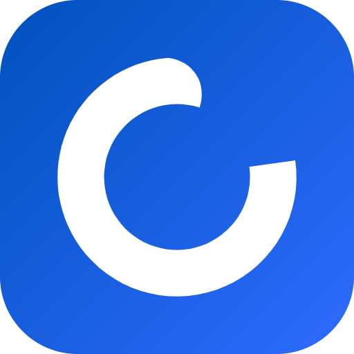

# Open Recorder

A free screen + webcam recorder **and editor** for Windows. I built it to film the lectures for my
coding program, because I wanted something free and stable that does exactly this. It records your
screen and your face at the same time, shows your face in a round bubble while you talk, and the
controls never show up in the video.

Then you edit right there: a simple timeline to cut, trim and move clips, your face as a circle or
a square anywhere on the frame, landscape or vertical, and an AI that makes the cuts for you on
your own Claude or ChatGPT subscription.

It's the tool I use every day. Here's how to use it too.

---

## What it does

- **Records your screen and your webcam as two separate files**, so in the edit you can move your
  face, resize it, or cut the screen without touching the voice.
- **Shows your face in a round bubble** in the bottom-left corner while you record, so you see what
  your viewers will see. Drag it anywhere.
- **The bar and the bubble are invisible to the recording.** You see them on your monitor, the
  video doesn't.
- **Pause and resume as many times as you want.** When you stop, you get one video, not a folder of
  pieces.
- **Crash safe.** If the PC, the recorder or ffmpeg dies mid-recording, everything up to the last
  second is kept and joined into a normal video the next time you open it.
- **Keeps the camera and the screen in sync.** The camera always starts a fraction of a second
  before the screen. Open Recorder measures that gap on every recording and writes it into the file
  (see [What you get](#what-you-get)).
- **Warns you when the mic goes silent**: a live level meter in the bar, and three beeps if the mic
  stops picking anything up while you record.
- **Keeps your screen awake while recording**, so Windows doesn't turn the display off in the middle
  of a long explanation.
- **Uses your graphics card to encode** (Nvidia, Intel or AMD), and your CPU if there isn't one.
- **Global hotkeys** that work while any other app is in front.

**And the editor:**

- **Projects.** Pick one folder on the first launch. *Record now* saves straight into it; every
  *New project* is a named folder inside it, and every take you record in a project lands on its
  timeline.
- **A simple timeline**, laid out like the big editors but with only what you need: lanes for your
  face and voice, your screen, B-roll, music and blurs. Split, trim, move, delete, close gaps, split
  the sound from the picture, undo everything.
- **Your face where you want it.** Drag it, resize it, make it a circle or a rounded square. It
  starts bottom-left, the way it was recorded.
- **Any shape of video:** landscape 16:9, vertical 9:16 for Reels, Shorts and TikTok, square, or
  4:5. The layout follows.
- **Blur** a part of the screen (a password, an email) for as long as you need.
- **An AI that edits.** Ask "cut the silences" or "remove the repeated takes" and it changes the
  timeline. It runs on the Claude Code or Codex you already use, on your own subscription. Every AI
  edit is one Ctrl+Z.
- **Export** to an MP4 at the canvas size, with your graphics card doing the work.

---

## What you need

- **Windows 10 (version 2004 or newer) or Windows 11.** It's Windows only.
- **Python 3.10 or newer:** [python.org/downloads](https://www.python.org/downloads/). Tick
  "Add python.exe to PATH" in the installer.
- **ffmpeg**, the video engine. Open a terminal and run:
  ```
  winget install Gyan.FFmpeg
  ```
  Close the terminal and open a new one afterwards, so it can find ffmpeg.
- A webcam and a mic. Both are optional: it can record just the screen, or just the camera.

---

## Install (about 5 minutes)

**1. Install it**

```
pip install git+https://github.com/huseinaa/open-recorder.git
```

No git? Download the ZIP from the GitHub page (**Code > Download ZIP**), unzip it, open a terminal
in that folder and run `pip install .`

**2. Check everything**

```
open-recorder --check
```

Every line should say `OK`. A `MISS` line tells you exactly what to install. A `NOTE` is fine, it's
just worth knowing (for example, which screens get the fast capture).

**3. Put it on your Desktop**

```
open-recorder --shortcut
```

This makes an **Open Recorder** shortcut on your Desktop that opens it with no terminal window.

---

## Use it

Double-click the shortcut (or run `open-recorder` in a terminal). The first time, it asks for one
folder: your recordings and your projects all go in it.

Then you get the start screen:

- **Record now** opens the recorder bar. Takes are saved straight into your folder. When you stop,
  the editor offers to open the take.
- **New project** asks for a name and a canvas shape (landscape, vertical, square, portrait) and
  makes a folder for it inside your folder. Press **Record** in a project and every take you make
  lands at the end of its timeline.
- Your recent projects are underneath. *Open a folder* opens any folder of recordings as a project.
  Right-click a project (or use its **⋯** button) to rename it or delete it. Deleting sends its
  folder to the Recycle Bin, so you can restore it.

### Recording

When you record, the editor gets out of the way and a bar appears at the top of the screen with
three cards:

| Card | Toggle | Menu (the arrow) |
|---|---|---|
| **Screen** | record the screen or not | which monitor |
| **Camera** | record the webcam or not | which camera |
| **Mic** | record your voice or not | which microphone |

Then:

| Action | Button | Hotkey |
|---|---|---|
| Start recording | the big **rec** button | `Ctrl+Alt+R` |
| Pause / resume | pause | `Ctrl+Alt+P` |
| Stop and save | stop | `Ctrl+Alt+R` |
| Throw this recording away and start again | restart | |
| Open or change the save folder | the folder icon | |
| Shrink the bar to a small timer | the minimize icon | |

One beep = recording started (start talking after it). Two beeps = stopped and saved. Three fast
high beeps = something's wrong (the mic went silent, or the recording broke), and the bar says
which.

Want just the bar, no editor? `open-recorder --record`.

### Editing

The editor has four panels: **Project** (your takes and files) on the left, **Program** (the video)
in the middle, **Effect Controls** and **AI** on the right, and the **timeline** across the bottom.

- Drag a take or a file onto the timeline, or double-click it. Drop files in from Explorer too.
- Click a clip to select it. Your face and screen are linked, so they move and cut together; the
  chain button in the timeline turns that off.
- Select your face clip and drag it on the video, pull a corner to resize it, and pick circle,
  square or none in the small bar above it.
- Right-click a take or a file to delete it. It goes to the Recycle Bin, and its clips leave the
  timeline. A file you linked from another folder is only removed from the project.
- **+ Lane** adds a lane for B-roll, music or a blur.
- **Export** (top right) renders an MP4 into the project's `Exports` folder.

| Shortcut | What it does |
|---|---|
| `Space` | play / pause |
| `V` / `C` / `B` / `H` | Selection, Razor (click to split), Ripple trim (shorten and close the gap), Hand |
| `S` | split at the playhead |
| `Delete` / `Shift+Delete` | delete / delete and close the gap |
| `Ctrl+Z` / `Ctrl+Shift+Z` | undo / redo |
| `Left` / `Right` | one frame back / forward (`Shift` for one second) |
| `Home` / `End` | start / end |
| `+` / `-`, `Ctrl` + wheel | zoom the timeline |
| `R` | record a take into this project |
| `Ctrl+E` | export |

---

## The AI

Open the **AI** tab. It walks you through two things:

**1. Connect Claude or Codex.** The AI is the command-line agent you already have, signed in with
your own account:

- **Claude**: install [Claude Code](https://docs.claude.com/en/docs/claude-code/setup), run
  `claude` in a terminal once and sign in. Then press **Connect Claude**.
- **Codex**: install the [Codex CLI](https://developers.openai.com/codex/cli), run `codex login`.
  Then press **Connect Codex**.

Connect both and the second one answers whenever the first is out of usage.

**2. Pick how your voice is transcribed**, so the AI knows what you said and can cut retakes and
mistakes, not only silences:

- **Whisper**: free, runs on your PC, nothing is uploaded. The app downloads it once (about 500 MB
  for the recommended size). The same as `pip install "open-recorder[ai]"`.
- **AssemblyAI**: more accurate, especially with mixed languages and fast speech. Needs your own API
  key from [assemblyai.com](https://www.assemblyai.com), and the sound of each take is uploaded to
  them.
- Or skip it: the AI can still cut silences.

Then just ask: *"cut the silences"*, *"remove the repeated takes"*, *"make it vertical"*, *"blur the
top right corner for the first 5 seconds"*. The answer says what changed, with an **Undo** button.

**How it runs.** Open Recorder never signs you in to anything and never sees your password or
tokens. It runs the `claude` or `codex` program you installed, on your computer, with any API key
removed from its environment, so the work is billed to your subscription, not to a key. It sends
the AI the timeline and the transcript, never the video. (Anthropic doesn't allow third-party apps
to offer a Claude.ai login of their own, which is why it only uses the one you made yourself.)

---

## What you get

Every recording is a pair of files with the same id (the date and time you pressed record):

```
screen_20261105_194954.mp4   the screen, no sound
camera_20261105_194954.mp4   your webcam + your voice
```

With the camera switched off, your voice goes into the screen file instead.

**Syncing them in your editor.** The screen file carries a `screen_offset` tag: the seconds to add
to a time in the camera file to get the same moment in the screen file. It's usually around -0.5.
Read it with:

```
ffprobe -v error -show_entries format_tags=screen_offset -of csv=p=0 screen_20261105_194954.mp4
```

In practice: put the camera file on your timeline at 0, and the screen file at `-screen_offset`
seconds (so with -0.5, the screen starts 0.5 s later than the camera).

---

## Settings

Every toggle and device you pick in the bar is remembered. The settings file is at:

```
C:\Users\<you>\AppData\Local\Open Recorder\config.json
```

Close Open Recorder before editing it. The ones worth knowing:

| Setting | What it changes | Default |
|---|---|---|
| `output_dir` | the folder for recordings and projects (changeable in the editor's settings) | asked on first open |
| `fps` | frames per second of both files | `30` |
| `width`, `height` | the camera resolution it asks for first | `1920`, `1080` |
| `encoder` | `auto`, `h264_nvenc` (Nvidia), `h264_qsv` (Intel), `h264_amf` (AMD) or `libx264` (CPU) | `auto` |
| `quality` | lower = sharper and bigger files | `19` |
| `bubble_size` | the face bubble on screen, in pixels | `300` |
| `bubble_margin` | its distance from the corner, in pixels | `25` |
| `bar_scale` | the size of the bar (`1.0` = large) | `0.75` |
| `hotkey_record_stop`, `hotkey_pause` | for example `ctrl+alt+r`, `ctrl+shift+f9` | |
| `silent_mic_db`, `silent_mic_seconds` | how quiet, for how long, before the silent-mic beeps | `-75`, `4` |
| `theme` | colours, for example `{"accent": "#E5484D"}` for a red record button | |
| `claude_model`, `claude_effort` | the model and effort the AI uses with Claude (also in the editor's settings) | `sonnet`, `medium` |
| `codex_model`, `codex_effort` | the same for Codex (empty = Codex's default) | `""`, `medium` |
| `transcriber` | `whisper`, `assemblyai`, or `skip` | asked in the AI tab |
| `whisper_model`, `whisper_device` | `tiny`, `base`, `small` or `medium`; `cpu` or `cuda` | `small`, `cpu` |

The colour names for `theme` are in [`src/open_recorder/recorder/ui/theme.py`](src/open_recorder/recorder/ui/theme.py).

---

## If something goes wrong

- **Everything is logged** to `C:\Users\<you>\AppData\Local\Open Recorder\Logs\recorder.log`,
  ffmpeg's own messages included. That's the first place to look, and the file to attach if you
  open an issue.
- **"Recovered 1 recording from last time"** means the last session didn't close properly. Nothing
  was lost: it's saved in your folder like any other recording.
- **One screen says "slower capture" in `--check`.** Laptops with two graphics chips (the laptop
  screen on one, an external monitor on the other) are handled automatically. If a screen still
  can't use the fast capture, it records at about 18 fps instead of 30. Make sure the screen is
  awake when you run the check.
- **The camera shows "No picture".** Another app (Zoom, Teams, the Camera app) may be using it.
  Close that app, then pick the camera again from the camera menu.
- **A hotkey does nothing.** Another app has taken it. Change it in the settings file.

---

## For developers

```
git clone https://github.com/huseinaa/open-recorder.git
cd open-recorder
pip install -e ".[dev]"
pytest
```

`open-recorder --selftest` records, pauses and resumes twice, stops and quits on its own (about 25
seconds), which is the quickest way to check a recorder change end to end.
`open-recorder --visible` leaves the bar and bubble visible to capture, for taking screenshots of
the recorder itself. `open-recorder --debug` opens the editor with the web inspector.

`python tools/ui_harness.py OUT_DIR` drives the editor's real back end and page in a headless Edge
(needs `pip install playwright`), walks every screen and saves screenshots, with no window on your
screen. Add `--ai` to include one real AI edit.

`python tools/make_icon.py` draws the logo (the numbers for the ring and the colours are at the top
of the file) and writes every file that shows it: the app icon, the README image, the editor's
favicon and the mark in its top bar.

The code is in layers that only call downward: the page, then `editor/`, then the services, then
`core/`.

| Package | What's in it |
|---|---|
| `recorder/` | the recorder bar: state machine (`app.py`), ffmpeg capture, segments and crash recovery, screens, the bar and bubble UI |
| `core/` | the project model, the edit language (`core/ops/`, every change is an op), undo, default layouts per canvas shape. Pure Python, no I/O |
| `project/` | projects on disk: the root folder library, `project.json`, finding takes and pairing screen + camera |
| `media/` | ffprobe facts, thumbnail strips, waveforms, silence detection, all cached in the project |
| `export/` | the project as one ffmpeg command (`graph.py`, pure), masks, the running export |
| `ai/` | Claude and Codex runners, the fallback router, the answer schema, the prompt, one chat turn |
| `transcribe/` | Whisper and AssemblyAI behind one interface, the transcript cache |
| `editor/` | the window (pywebview), the local media server, the API the page calls, the session, background jobs, the link to the recorder |
| `editor/ui/` | the page: plain HTML, CSS and JavaScript modules, no build step |
| `ffmpeg.py`, `config.py`, `win32.py`, `check.py` | shared: finding ffmpeg, the settings file, Windows calls, `--check` |

---

Built by Husein, [unemployedhusein.com](https://unemployedhusein.com). If you record something with
it, send it to me. MIT licensed.
